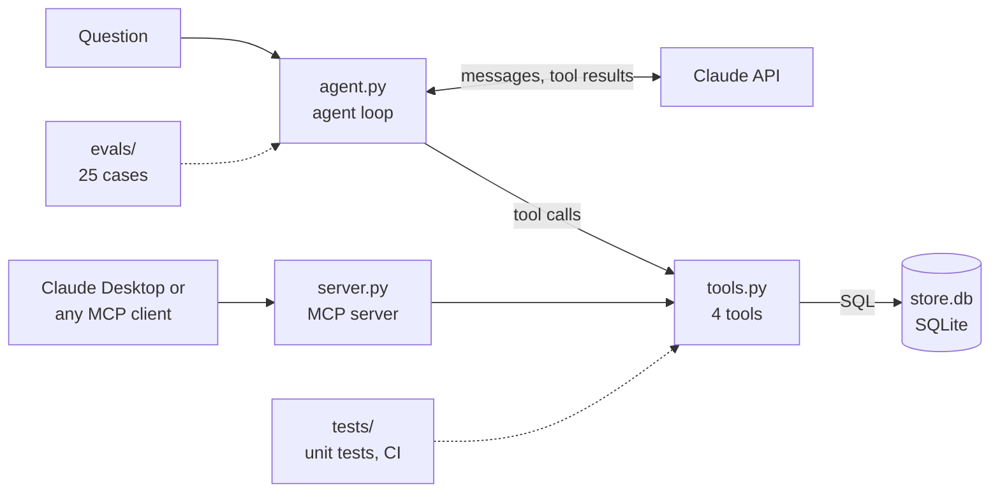

# commerce-ops-agent


An AI agent that answers e-commerce operations questions (stuck orders, revenue, top customers, cancellations) by calling tools over the store's data instead of guessing. The same tools are published as an MCP server, so Claude Desktop or any other MCP client can use them too.

I work on Shopify and NetSuite integrations, and I built this to tackle the AI side of that world: getting exact numbers out of an LLM system, and proving it with evals.

**Demo (3 min):** https://youtu.be/tKpJAmB9jJ4

[](https://youtu.be/tKpJAmB9jJ4)

## What it looks like

```
$ uv run --env-file .env agent.py "Which customer has the most open orders?"
-> order_stats({'status': 'unfulfilled', 'group_by': 'customer'})
Bilal Ahmed has the most open (unfulfilled) orders. He has 4 orders, 13 units and PKR 22,500 in revenue.
Next are Ayesha Khan and Hina Raza with 3 orders each. Usman Tariq has 2 and Sara Malik has 1.
```

The `->` lines are the agent's tool calls, so you can always see where an answer came from.

## How it works



- `tools.py`: four tools over a SQLite store: `get_orders`, `get_order`, `get_customer` and `order_stats`.
- `agent.py`: the agent loop, written against the Anthropic API directly, no framework. It sends the question and the tool list, runs whatever tool the model asks for, sends the result back, and repeats until the model answers. Capped at 10 steps.
- `server.py`: an MCP server (stdio) that publishes the same four functions. The tool schemas come from type hints and docstrings.
- `make_data.py`: generates 30 Shopify-style orders into `store.db`. Fixed seed, so the data and the expected answers never change.

## Design decisions

- **Code does the maths; the model decides what to compute.** An early version let the model count, and it listed 13 orders and called it 12. Now every count, total and age comes from SQL (`count`, `age_days`, `order_stats`), and the prompt tells the model to use those numbers.
- **Business rules live in the prompt.** "Revenue" means fulfilled orders. Before that rule, "What is our total revenue?" took 3 tool calls and hedged with two numbers. After it: one call, one answer, and the eval checks both.
- **Model output is untrusted input.** Values go into SQL as parameters. Names, like the sort column, come from an allowlist, so text from the model (or a prompt injection hidden in the data) never becomes SQL. A unit test covers it.
- **One set of tools, two front ends.** The agent and the MCP server share `tools.py`; the server is a thin layer on top.

## Testing and evals

| Layer | What it checks | Cost | When |
|---|---|---|---|
| Unit tests (`tests/`) | The tools compute the right numbers and handle hostile input safely | Free, under a second | Every push (GitHub Actions) |
| Evals (`evals/`) | The model picks the right tools and gives the right answer | A few cents, about 90 s | Before every change to prompts or tools |

There are 25 eval cases, with expected answers computed straight from the database. Each case can check facts that must appear, facts that must not appear, which tool was used, and a maximum number of tool calls. Some are deliberately hard: a tie between two customers, a cancellation just outside "this week", an average that no tool computes, and a question the data can't answer (refunds).

Latest results, 3 runs: 24/25, 25/25, 24/25. The one failure was in the test, not the agent: it answered "the tools I have don't track refunds", a correct answer worded in a way the string check didn't accept. That's fixed, and it's the reason an LLM-as-judge is next.

## Run it

```bash
uv sync
uv run make_data.py                               # builds store.db
echo "ANTHROPIC_API_KEY=sk-ant-..." > .env
uv run --env-file .env agent.py "Which orders are stuck?"

uv run pytest tests -v                            # unit tests, no API key needed
uv run --env-file .env pytest evals -v            # evals, calls the model
```

### Use it from Claude Desktop

Add this to `claude_desktop_config.json` (Settings → Developer → Edit Config), then restart Claude Desktop:

```json
{
  "mcpServers": {
    "commerce-ops": {
      "command": "/full/path/to/uv",
      "args": ["--directory", "/full/path/to/commerce-ops-agent", "run", "server.py"]
    }
  }
}
```

## What's next

- An LLM-as-judge for answers that are right but worded differently
- Retrieval over operations runbooks (a `search_docs` tool)
- A webhook service (FastAPI + Kafka) that triages new orders and asks for approval in Slack before acting

Day-by-day build notes: [notes.md](notes.md)
